# Dashboard

The dashboard is the browser app served by `graph-studio`. This page gives you a tour of
the screen, then walks through the everyday tasks step by step: editing, generating,
reviewing, following jobs and exporting. For the editing rules, previews and REST
routes, see the [Studio reference](GRAPH-STUDIO.md).

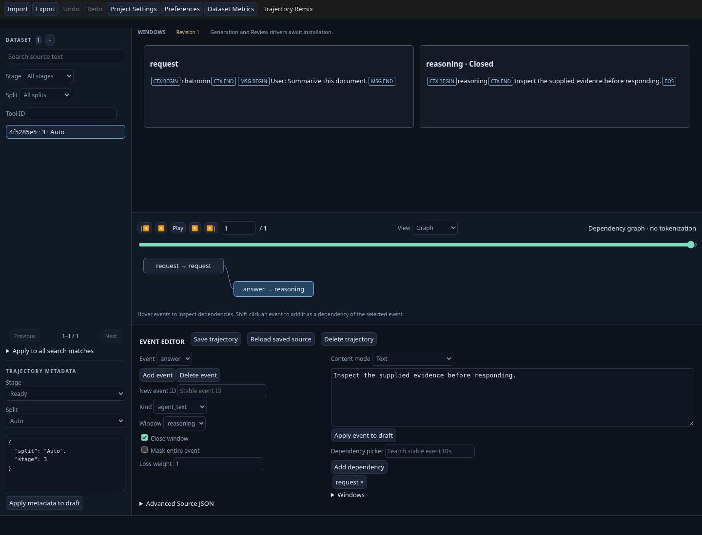

## The layout

The studio fits on one screen. Instead of scrolling a long page, you switch **views**
with the tabs at the top and reveal detail with tabs, menus and tooltips.

| Area | What it does |
| --- | --- |
| **View tabs** | **Editor**, **Jobs**, **Metrics** and **Sampler**. A badge on Jobs counts running and paused jobs. |
| **Header actions** | **Undo** and **Redo**, the **Project** menu (import, export, preferences), the **View** menu (show or hide editor panels), **Settings** and **Generate**. **Review Settings** is a tab next to **Sampler**. |
| **Status bar** | The latest message on the left. On the right, one chip per active job with a progress bar. Click a chip to open that job. |

Hover anything with an **ⓘ** for an explanation. Units, reasons and definitions live in
tooltips rather than in extra text on screen.

### The Editor view

| Panel | What it does |
| --- | --- |
| **Dataset** (left) | Search and filter trajectories by text, stage, split or tool. Each row shows a short ID, its stage and split, and a lock if a job owns it. Hover a row for the full ID. |
| **Trajectory bar** (top) | The selected trajectory's ID, save state and problem count, its **Stage** and **Split**, and **Save**. **More** holds Reload and Delete. |
| **Windows** (centre) | One card per context window, as it looks at the current timeline position, in a readable view. **Raw** shows the exact tokens; the expand button opens the window in a large panel. |
| **Timeline** (bottom) | One lane per window. Click an event to edit it; Shift-click to make it a dependency of the selected event. Scrub, step or press **Play**. |
| **Event editor** (right) | Tabs for the selected event: **Content**, **Links** (dependencies), **Options** (closing, masks, delivery, framing), **Windows**, **Problems** and **JSON**. |

Each window keeps **one colour** everywhere: its card, its timeline lane and its event
blocks. That makes it easy to follow one window across the screen.

#### Reading windows

The readable view only changes how a window looks. The tokens, masks and training data
are untouched, and **Raw** on any card switches back to the exact token stream.

| You see | What it is |
| --- | --- |
| **Chat bubbles** | Messages in a `chatroom` window. The agent's messages sit on the right; each other speaker keeps one colour. |
| **Formatted JSON** | Tool calls, tool results and other JSON, indented and colour-coded even while it is still streaming. |
| **Context** line | The window's header, such as its purpose and reasoning effort. |
| **Streaming** tag, dashed border | A message, call or result whose end marker hasn't arrived at this position. |
| **NOOP ×N** | In Tick history, an open window the agent can write to predicts NOOP on every tick it has nothing to say. NOOP is a training label ("wait"), not window content: it never enters the context. A run of them is shown as one chip with a count. |

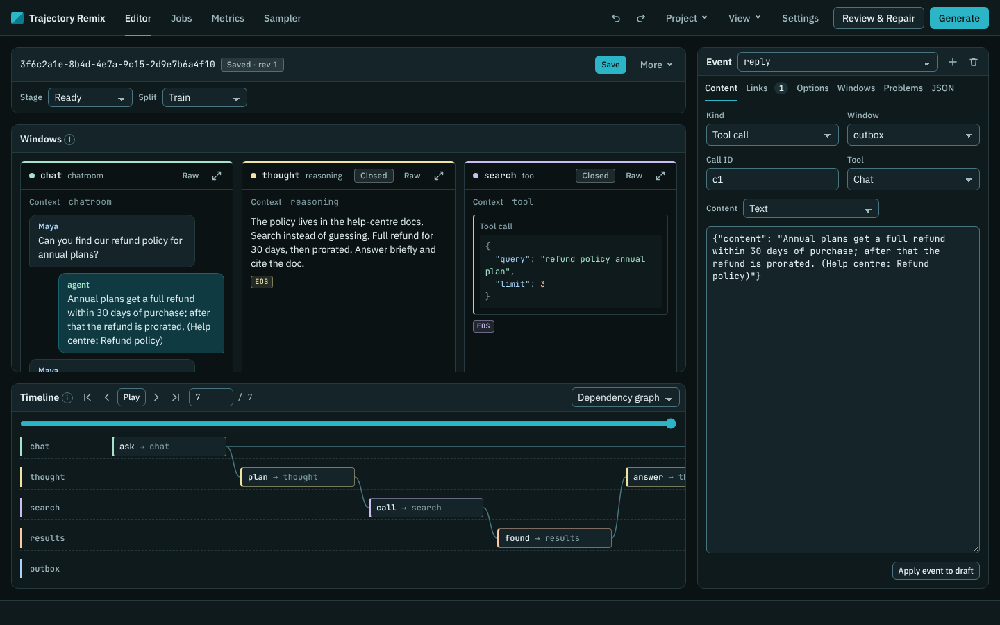

### The Jobs view

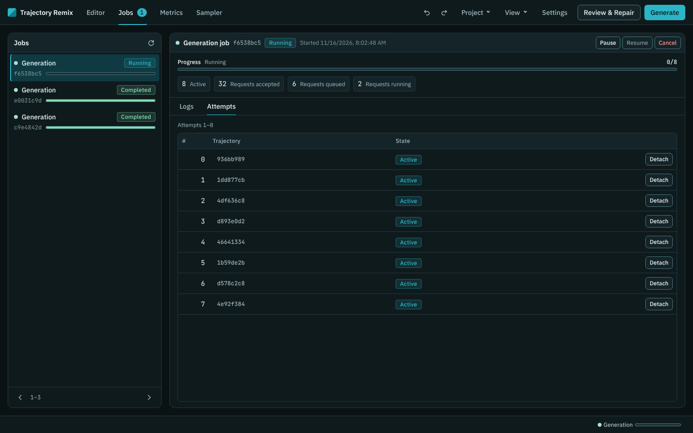

The list on the left shows every job with its kind, state and progress. Select one to see
its progress bar, counts, controls and tabs for **Logs**, **Attempts** (generation),
**Results** (bulk edits and reviews) and **Files** (exports). The page updates in place
while you watch, so it never flickers or loses your scroll position.

### The Metrics view

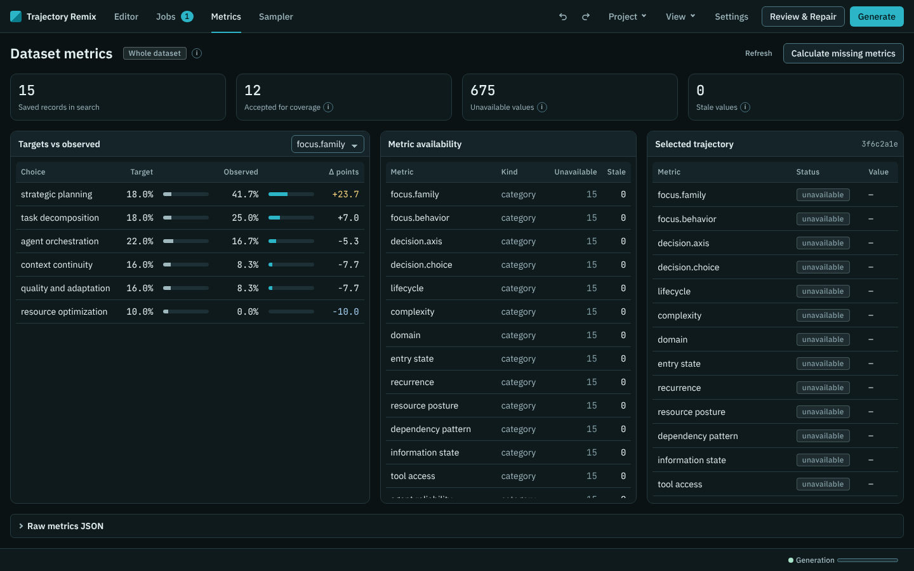

Summary tiles, then target-versus-observed shares per sampler dimension, which metrics
are measured, and the selected trajectory's values. It covers the same search and
filters as the Editor's dataset panel. See [Metrics](METRICS.md).

### The Sampler view

The weights and rules that decide what each generated trajectory is about. It has its
own guide: [Sampler Matrix](SAMPLER-WORKBENCH.md).

## Set up and generate

1. **Add a model endpoint.** Click **Settings**. On **Models & defaults**, enter an
   endpoint ID and click **Add endpoint**, then fill in the base URL, the exact model
   name, a concurrent-request limit and a retry count. Assign the *Generator*,
   *Fast Review* and *Critical Review* roles. One endpoint can serve every role. Details,
   including credentials, are in [Project settings](PROJECT-SETTINGS.md).
2. **Save settings.** New projects include a default `chat` tool input schema, so the
   standard flow produces a chatroom reply. Removing it is your choice.
3. **Set up review (optional).** Open the **Review Settings** tab to choose automatic
   review and repair options and edit the Core and Critical checklists. Click
   **Save review settings** if you change them.
4. **Open Generate.** It shows which endpoint fills each role, any pins from the
   Sampler, and the **Flow** that will build the trajectories.
5. **Tune the sampler (optional).** **Open Sampler** jumps to the weights and pins.
6. **Start.** Set the number of attempts and a starting seed, then click
   **Start generation**. The new job opens in the Jobs view.

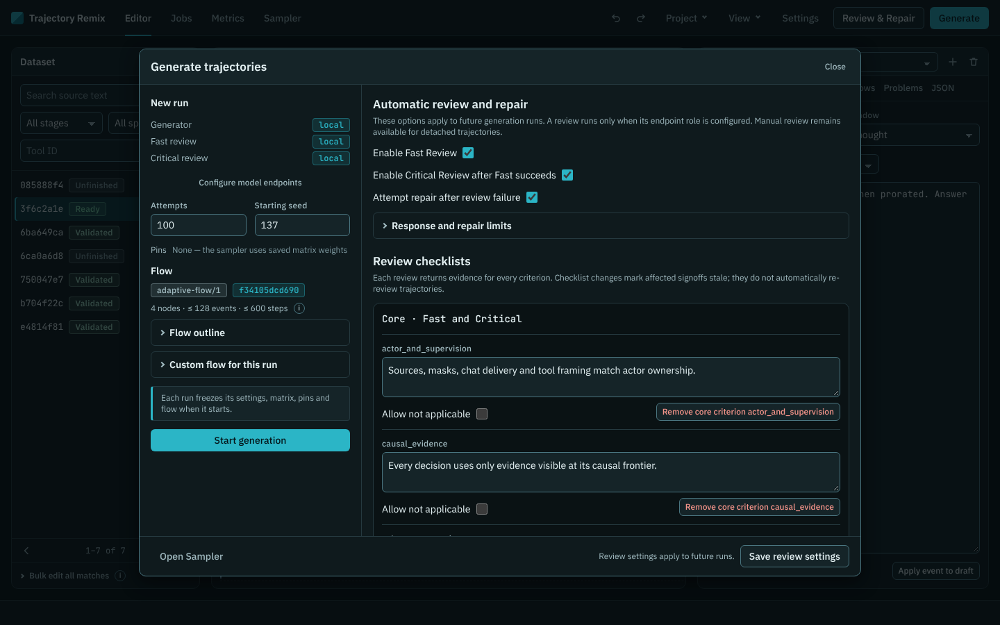

A run **freezes** its settings, matrix, pins and flow when it starts, so later edits only
affect future runs. Generated trajectories are never automatically Ready.

## Tutorials

Short recipes for common tasks. Each assumes the studio is open in your browser.

### Create and edit a trajectory by hand

1. In the **Dataset** panel, click **+**. A new, empty trajectory is selected, with one
   window called `reasoning`.
2. In the event editor, click **+** to add an event. It starts as agent text in the first
   window.
3. On the **Content** tab, choose a **Kind** and **Window**, then type the content. The
   windows and timeline update as you type.
4. Need another window? Open the **Windows** tab, type a new window ID and purpose, and
   click **Add / update window**.
5. Set the trajectory's **Stage** and **Split** in the trajectory bar, then click
   **Save**. The badge changes from *Unsaved draft* to *Saved · rev N*.

You can switch to another trajectory without saving. Your draft is kept and comes back
when you return.

### Link events in order

Events in the same window must be ordered, and events in different windows run in
parallel unless you link them.

1. Select the later event.
2. Either **Shift-click** the earlier event in the timeline, or open the **Links** tab,
   pick an event ID and click **Add**.
3. To remove a dependency, click its chip on the Links tab.

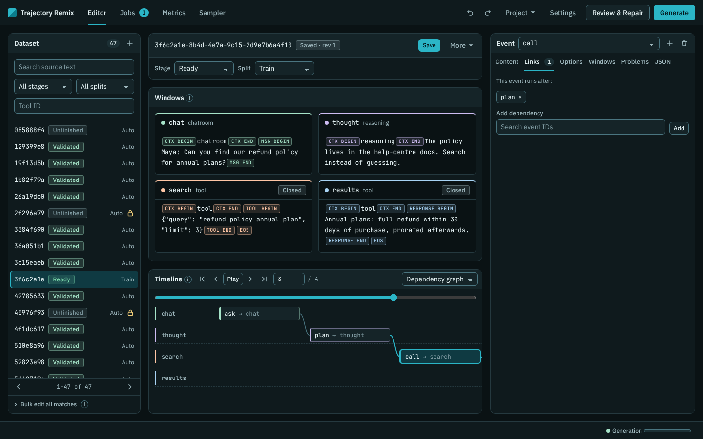

### Fix problems in a draft

Broken drafts always save. Problems show up as you edit:

- The trajectory bar shows a red **errors** or amber **warnings** tag. Click it to open the
  **Problems** tab.
- Each problem has a code, a message and, where it applies, **Inspect event** to jump to
  the event.
- Errors block compiled export; warnings don't.

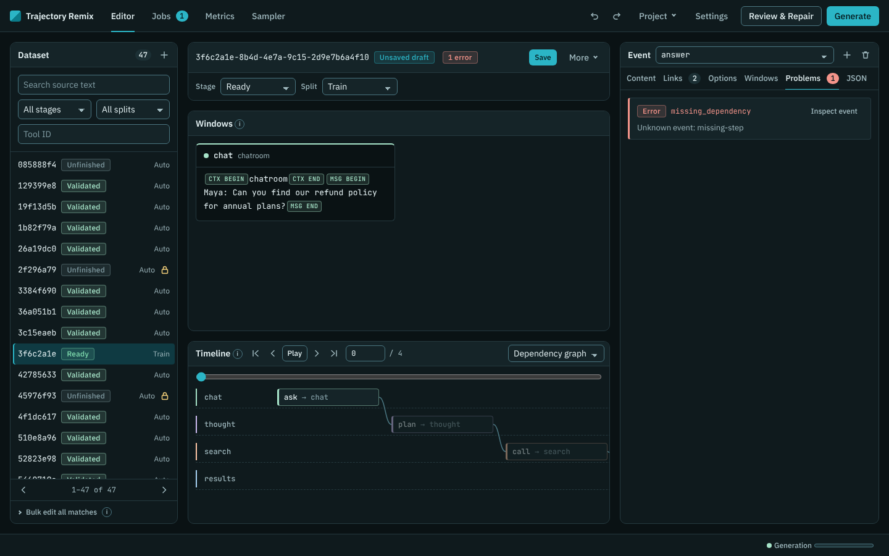

### Preview the tokens

1. Add a tokenizer profile in **Settings** (see
   [Project settings](PROJECT-SETTINGS.md#tokenizer-profiles)).
2. Open **Project → Preferences…** and choose it as the **Preview tokenizer**.
3. In the timeline, switch **Dependency graph** to **Tick history**. Scrub to watch each
   window fill tick by tick.

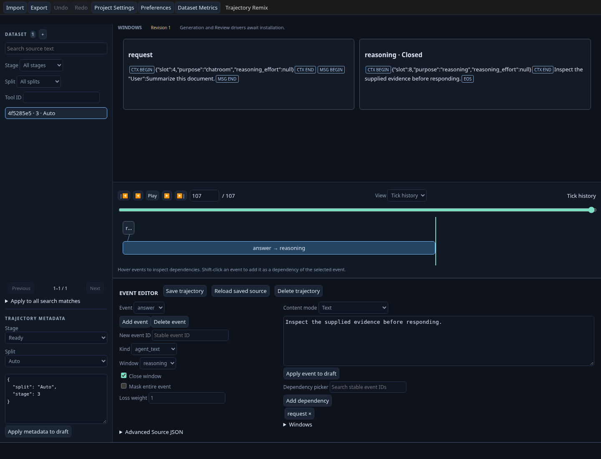

### Read a conversation or a tool call

1. Scrub the timeline to the position you want.
2. Chatroom windows show the conversation as bubbles; tool windows show calls and results
   as formatted JSON.
3. Click the **expand** button (two outward arrows) on a window card to read it in a large
   panel. The panel follows the timeline, and its own arrows step backward and forward.
4. Click **shrink** (or press **Esc**) to return to the grid.
5. Need the exact tokens? Click **Raw** on the card. Click it again for the readable view.

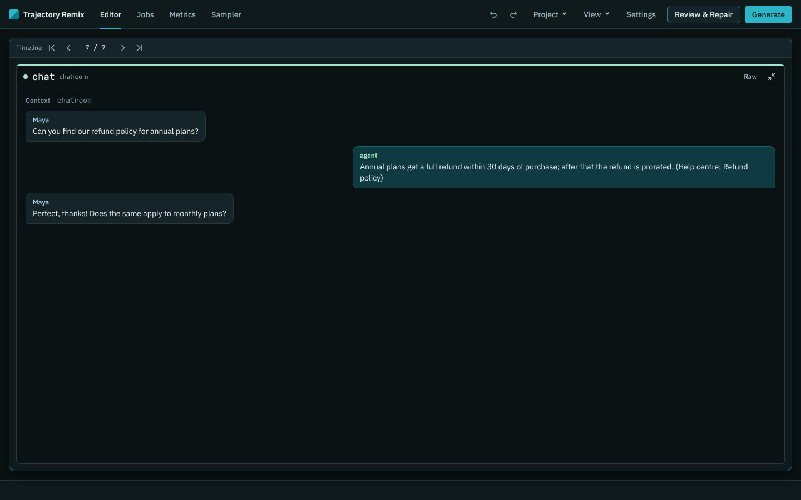

### Rearrange the editor

Open the **View** menu and choose **Hide dataset panel**, **Hide timeline panel** or
**Hide event panel**; the same items read **Show …** to bring a panel back, and
**Show all panels** restores everything. The windows grow into the freed space. Your
layout is remembered in this browser.

### Choose how trajectories are built

On a backend with **adaptive flows**, the Generate dialog's **Flow** section shows the
policy that builds each trajectory: its version, a hash, its limits and an outline of its
nodes (hover a node for its instruction).

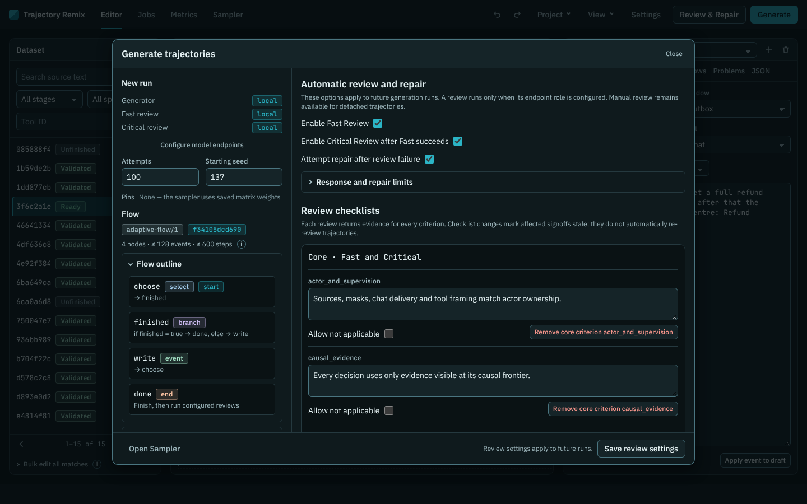

- **For every future run**, edit `flow.yaml` beside the project database. The studio has
  no file editor for it; the next run picks it up. See
  [Event generation](GRAPH-GENERATION.md).
- **For one run**, open **Custom flow for this run**. It starts as the current flow written
  as YAML. Edit it, make sure **Use this YAML for the next run only** is ticked, and start
  the run. Invalid YAML is rejected before any attempt is reserved, and `flow.yaml` on disk
  is not changed.

Trajectories finished by the flow show a **Flow finished** tag in the trajectory bar. Hover
it for the generation controller's own finish explanation. It describes intent, not
measured coverage.

On an older backend, the section says the server uses its built-in recipe and runs
behave as before.

### Import and export

- **Import:** **Project → Import trajectories…**, then choose a `.json` or `.jsonl` file.
  The import runs as a job and opens in the Jobs view.
- **Export:** **Project → Export dataset…**. Choose raw JSONL or compiled KTREMIX, the
  minimum stage and the metadata to keep, then **Start export**. When the job completes,
  its **Files** tab has the download buttons. Files expire after 24 hours. See
  [Export](EXPORT.md).

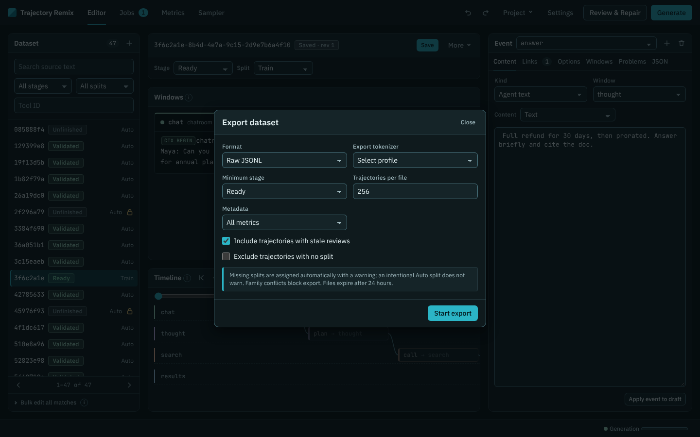

### Review and repair trajectories

1. Save the trajectory you want reviewed, or set up a search that matches the ones you
   want.
2. For one trajectory, open **More** in the trajectory header and choose **Review** or
   **Review & Repair**. For every search match, open **Bulk edit all matches**, pick
   **Review** or **Review & Repair** as the action, and click **Apply**.
3. Follow the job in Jobs. A message appears when it finishes.

**Review** only records a verdict. **Review & Repair** also attempts a repair after a
failure. Both use standard mode: Pending trajectories get the Fast review and Candidate
trajectories get the Critical review.

The **Review Settings** tab holds the automatic review and repair settings and the review
checklists.

### Change many trajectories at once

1. Filter the dataset to the trajectories you want.
2. Open **Bulk edit all matches** at the bottom of the Dataset panel.
3. Choose **Set stage**, **Set split**, **Review**, **Review & Repair** or **Delete**, enter the value (a stage number such
   as `3` for Ready, or a split name; review and delete need none), and click **Apply**.

Bulk edits skip locked trajectories and can be undone with **Undo** once they finish.

### Follow, pause and resume a job

1. Click a job chip in the status bar, or open the **Jobs** tab and select a job.
2. Use **Pause**, **Resume** or **Cancel** in the job header. These buttons only appear
   while the job is still active.
3. On a generation job, the **Attempts** tab lists each trajectory. Click an ID to open it
   in the Editor, or **Detach** to stop automatic work on it so you can edit by hand.

### Check dataset coverage

1. Set the Editor's search and filters (or leave them empty for the whole dataset).
2. Open **Metrics**. Pick a dimension in **Targets vs observed** to compare what the
   sampler aimed for with what accepted trajectories contain.
3. Click **Calculate missing metrics** to measure what can be measured. It runs as a job.

## Watch and recover work

**Jobs** lists every job, paginated. Selecting one shows its progress, retained logs, and
**Pause**, **Resume** and **Cancel**. Leaving the Jobs view never stops a job, because
the server owns the work. A trajectory that a job is working on shows a lock and an
**Inspect owning job** button.

Two kinds of "resume" are separate:

- **Endpoint Resume** restarts an endpoint that paused after its retries ran out. It
  appears as a warning in the job's summary.
- **Job Resume** restarts a job you or a restart paused.

If the server restarts, jobs come back **paused**, with unfinished model text
discarded and completed events kept. Nothing restarts on its own, so you resume
deliberately. See [Jobs](GRAPH-JOBS.md) for the full recovery model.

## Live updates and conflicts

While a pipeline works on a trajectory, the clean copy you have selected refreshes as
events arrive, and unlocks when the work ends.

- **Locked** trajectories can't be edited. Ownership is exclusive, and Save is hidden
  until the lock clears.
- If you have **unsaved edits**, they are never overwritten. A conflicting save reports
  a revision conflict and leaves your text intact. Reloading the saved version is an
  explicit step (**More → Reload saved source**).
- **Detaching** a trajectory from its pipeline is permanent. That pipeline stops
  updating it, and no review verdict is invented.

## Stages at a glance

| Stage | Meaning |
| --- | --- |
| Unfinished (-3) | Hand-made drafts, or generation that failed or ran out of context. |
| Pending (0) | Generated, waiting for review. |
| Candidate (1) / Unsuccessful (-1) | Passed or failed the Fast review. |
| Validated (2) / Rejected (-2) | Passed or failed the Critical review. |
| **Ready (3)** | Approved by you. This is what export includes by default. |

Changing a source or checklist can make an old review **stale**. Stale reviews keep
their stage and show a *Review stale* tag in the trajectory bar. Nothing is re-reviewed
unless you ask. See [Event generation](GRAPH-GENERATION.md#reviews-and-repair).

## Good to know

- The dashboard checks forms, generation, jobs, live refresh and settings round trips
  with mocked providers. That shows the app works, not that a model writes good
  content. See [Acceptance](ACCEPTANCE.md) for the current evidence.
- Preferences (such as the Tick history profile) and Undo history live in your browser,
  not in the project.
- Fonts are bundled with the app, so the studio needs no internet connection.

## For developers

The frontend is plain ES modules and CSS in `trajectory_remix/static/`, with no build
step. Element IDs used by the tests are stable; keep them when you rearrange markup.

| File | Responsibility |
| --- | --- |
| `graph.html` | App shell: header, the four views, status bar and dialogs. |
| `style.css` | Theme tokens (the *Dark Cyan Base* design system) and shared components: buttons, fields, widgets, tags, tabs, menus, progress bars, tooltips, dialogs, tables. |
| `graph.css` | Layout of the shell, Editor, Jobs and Metrics views and the status bar. |
| `sampler.css`, `project-settings.css` | The Sampler view and the settings forms. |
| `shell.js` | View tabs, disclosure menus, keyboard-navigable tab panels and the `[data-tip]` tooltip. |
| `views.js` | `showView()` / `currentView()`; dispatches a `studio-view` event that loads Jobs, Metrics and the Sampler on demand. |
| `ui-kit.js` | DOM helpers: keyed `reconcile()`, idempotent `setText`/`setAttr`/`toggleClass`, `progressBar()`, `makeTabs()`, stage and job tone maps. |
| `graph.js` | `StudioUI`, the editor controller: drafts, saving, previews, polling, history and dialogs. |
| `jobs-view.js` | `JobsView`: the job list and detail panel (`StudioUI.dialogs` maps job IDs to detail panels). |
| `metrics-view.js` | Renders the population and per-trajectory metrics payloads. |
| `window-render.js` | Readable window view: header fields, chat bubbles, tolerant JSON formatting, collapsed NOOP runs, and the Raw view. Visual only. |
| `flow-panel.js` | The Generate dialog's Flow section: `GET /generation/flow`, the node outline, and a lossless YAML writer for per-run `instructions.flow_yaml`. |
| `sampler.js`, `project-settings.js` | The Sampler workbench and the settings form editors. |

The poll loop runs every 1.5 s. Anything it renders must update in place: use
`reconcile()` for lists and the idempotent setters for text, attributes and classes, so
an unchanged poll produces no DOM mutations. `tests/studio_ui_frontend.mjs` checks this
with a `MutationObserver`.

Theme colours, type, spacing and radii come from CSS custom properties on `:root` in
`style.css`. Use the tokens (for example `var(--surface-200)` or `var(--space-3)`) rather
than literal values. Pastels (`--pastel-*`) are for tracking entities such as windows and
job kinds, and status always pairs a colour with a word.
