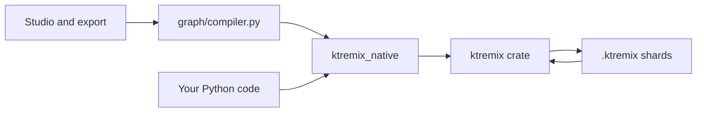

# Native compiler

This page explains how the KTREMIX compiler is packaged, so you can build on it, reuse
it from another project, or find your way around the source. For what the compiler
*does* to a trajectory, read [Compiler](GRAPH-COMPILER.md). For the file layout of
shards, read [KTREMIX format](KTREMIX.md).

## What is in the box

The compiler is written in Rust and lives under `native/`. The studio calls it through
a Python package, so Python users never write Rust.

| Piece | Location | Use it when |
| --- | --- | --- |
| `ktremix` Rust crate | [`native/ktremix`](../native/ktremix/README.md) | You work in Rust, or want the typed API and rustdoc |
| `ktremix-native` Python package | [`native/ktremix-python`](../native/ktremix-python/README.md) | You compile, convert or load shards from Python without installing Remix |
| `trajectory_remix.graph.compiler` | [`trajectory_remix/graph/compiler.py`](../trajectory_remix/graph/compiler.py) | You are inside the studio: it adapts studio models to the package above |



## What the Rust crate does

| Job | Where in the crate |
| --- | --- |
| Check a graph's structure without a tokenizer | `Compiler::structural_report` |
| Schedule a graph and build row, frame and window arrays | `Compiler::compile` |
| Write many compilations into one shard | `shard::CompileWriter` |
| Turn raw text or JSONL into interleaved training samples | `Compiler::convert_corpus` |
| Read samples back from a shard | `shard::Shard` |
| Draw weighted, optionally non-repeating batches | `dataset::Dataset` |

The same input, options and seed always produce the same bytes. Slot assignment
deliberately reproduces the original Python compiler's random sequence, so seeded
physical slot choices are unchanged by the move to Rust.

## Install

You need a stable Rust toolchain (1.89 or newer) to build from a checkout.

```bash
python -m pip install ./native/ktremix-python[numpy]
```

For the studio, `python -m pip install ./native/ktremix-python -e '.[mcp,export]'` from
the repository root installs both.

## Read the API docs

Every public Rust item has rustdoc. Build and open it with:

```bash
cargo doc --no-deps --open -p ktremix
```

Python modules, classes and methods have docstrings, so `help(ktremix_native.Compiler)`
works.

## For developers

| Check | Command |
| --- | --- |
| Rust format | `cargo fmt --all --check` |
| Rust lint | `cargo clippy --workspace --all-targets --locked -- -D warnings` |
| Rust tests | `cargo test --workspace --locked` |
| Rustdoc | `RUSTDOCFLAGS="-D warnings" cargo doc --no-deps -p ktremix` |
| Cross-language compatibility | `python -m pytest tests/test_ktremix_native.py` |

Source map for `native/ktremix/src`:

| File | Responsibility |
| --- | --- |
| `lib.rs` | Public re-exports, `Error` and crate-level docs |
| `model.rs` | Graph source types and the `Token`, `Emission` and `Frame` preview types |
| `diagnostics.rs` | Structural analysis and `Diagnostic` reporting |
| `compiler.rs` | `Compiler`, tokenizer profile handling, scheduling and preview |
| `runtime.rs` | Window lifecycle and the `Columns` arrays |
| `slots.rs` | Seeded physical slot choice (matches Python's `random.Random`) |
| `shard.rs` | Wire-format reader, atomic writer and `CompileWriter` |
| `corpus.rs` | Raw-text conversion |
| `dataset.rs` | Batched sampling across shards |
