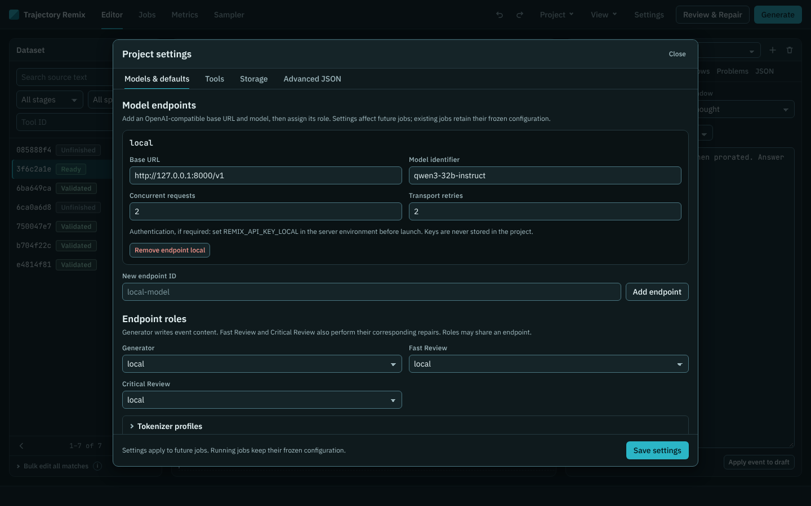

# Project settings

**Settings** (in the header) holds the things shared by everyone using a project: model
endpoints and roles, tokenizer profiles, tools and defaults, on the **Models & defaults**,
**Tools**, **Storage** and **Advanced JSON** tabs. The **Review Settings** tab holds review and
repair options and the review checklists.

Both are a shared local draft until you press **Save**. Closing a dialog or editing a
field never starts a model request, and running jobs keep the configuration they
started with.

## Configure a model endpoint

You bring your own OpenAI-compatible server. Remix doesn't launch, probe or download
models.

1. Start your server.
2. In **Settings → Models & defaults**, enter a unique endpoint ID and click **Add endpoint**.
3. Fill in the **base URL** (for example `http://127.0.0.1:8000/v1`; Remix adds
   `/chat/completions`), the exact **model** name, a **concurrent-request limit** and a
   **retry count** for transport errors.
4. Assign the roles from the dropdowns. One endpoint can fill all of them. Leave a review
   role empty to skip that review.

   | Role | Used for |
   |---|---|
   | **Draft** | The Draft stage of [Draft and Assembly](GRAPH-GENERATION.md#draft-and-assembly). Required to generate. Older projects with a Generator role are converted to Draft. |
   | **Assembly** | The Assembly stage and its fix. Optional; falls back to Draft. Give it a stronger model for better structure. |
   | **Fast Review** | Fast Review and its repair. |
   | **Critical Review** | Critical Review and its repair. |
5. **Save settings**, then open **Generate** to choose review and repair options.

Removing an endpoint also clears the roles that pointed at it. Saving that affects only
future work.

### Provider options

Open **Provider options** on an endpoint card for settings that matter mostly with
hosted routers such as OpenRouter. For a full walk-through, see [OpenRouter](OPENROUTER.md).

| Option | What it does |
| --- | --- |
| **Bytes per token** | How the context check estimates tokens: request bytes ÷ this number. The default, 1, can never undercount but rejects prompts that would fit. English and JSON average about 3.5 bytes per token, so **3** keeps a margin while letting you use the model's real window. |
| **Structured output** | How replies are held to the JSON schema. **Auto** uses native JSON-schema output where possible. **JSON object** always uses JSON mode with the schema written into the prompt. **Prompt only** sends no `response_format`, for servers that support neither. |
| **Sticky sessions** | Sends the trajectory ID as `session_id`, so a router keeps each trajectory on one provider and its prompt stays cached. |
| **Extra request fields** | A JSON object added to every request, for example `{"reasoning": {"effort": "none"}, "provider": {"require_parameters": true}}`. Fields Remix sets itself (model, messages, response format, output limit, sampling and `session_id`) cannot be overridden. |

### Credentials

If your server needs a key, set it in the environment **before starting Remix**. The
variable is `REMIX_API_KEY_<ENDPOINT>`, with the endpoint ID uppercased and hyphens
turned into underscores. For example, endpoint `local-model` reads
`REMIX_API_KEY_LOCAL_MODEL`. The endpoint card shows its variable name. Credentials
never go into project settings, sources, instructions or logs.

## Tokenizer profiles

You only need a profile for **Tick history** preview and for compiled export. Graph
authoring, generation, review and metrics never touch a tokenizer.

1. Expand **Tokenizer profiles**, enter an ID and choose the tokenizer's JSON file.
2. Map all twelve logical controls to dedicated special tokens that already exist in
   the file. Recognized spellings are preselected, and you can pick others.
3. Save. Profiles with missing or duplicate mappings are rejected, as are files with
   fewer than twelve dedicated special tokens. Remix never extends the vocabulary.

The twelve controls are `bos`, `eos`, `noop`, `ctx_begin`, `ctx_end`, `tool_begin`,
`tool_end`, `response_begin`, `response_end`, `msg_begin`, `msg_end` and `window_ref`.

Pick the preview profile in **Project → Preferences…** (stored in your browser) and the
export profile in the Export dialog. They are chosen independently.

## Tools

The tool list is a catalogue of **input schemas** (JSON Schema). Tools have no code and
no output schema: authors and models write the results. The settings form can create an
object schema and add or remove fields and required flags. Advanced JSON keeps nested or
custom schemas. Removing a tool keeps the existing calls that use it. See
[Synthetic tools and chat](TOOLS.md).

Give each schema a top-level `description`. The generation controller and the event
writers see only the catalogue, so the description is how they learn what a tool is for.
Describe what the tool does for the agent, not how it might be simulated.

### Import a tool catalogue

**Settings → Tools → Import tools from JSON…** merges a file of tool definitions into the
settings draft. The file may be a whole settings file or just `{"tools": {id: definition}}`.
Tools you already have are kept unless you tick **Replace tools with the same ID**. Nothing
is saved until you choose **Save settings**.

Two starting catalogues for a coordinating agent come with Remix:

| File | Contents |
| --- | --- |
| [`kidra_tools_core.json`](../examples/kidra_tools_core.json) | 16 tools, about 5.7 KB: specialist delegation (`subagent`, `subagent_get`, `subagent_list`, `subagent_close`), task notes, basic files, memory, web search, calculator and time. A good default. |
| [`kidra_tools.json`](../examples/kidra_tools.json) | All 30 tools, about 11 KB: the core set plus file patch, copy, move, rename, delete and watch, skills, web find, timers and system diagnostics. |

Every Draft and Assembly request includes the whole catalogue, so a larger one costs context
and tokens on every trajectory. Prefer the core set and add what your episodes need. `subagent`
takes an optional `agent`, the specialist chosen from the roster the episode shows.

## Defaults

| Setting | Notes |
| --- | --- |
| Train / development / test fractions | Must total 1. Used when export assigns splits. |
| Reasoning effort levels | Defaults to Low, Medium and High. |
| Log cache size (MiB) | Project-wide retained log cap. Default 1024, blank means unlimited. |
| Random extra tools (%) | Chance that each tool you didn't choose is still listed in a `tool_schema` event, so the agent learns to ignore unneeded tools. Default 50, `0` turns it off. Applies to Assembly and to manual tool checkboxes. |

## Review criteria

In the **Review Settings** tab, each criterion is a line of text with an optional
**not-applicable** allowance. Add or remove criteria in the **Core** and **Critical**
lists. Fast review checks Core, and Critical review checks Core plus Critical.

Changing a checklist marks affected sign-offs **stale**. Their stages are kept, and you
re-review manually. Form edits preserve unrelated fields, and the advanced project
JSON remains for unusual settings.

### Default criteria

A new project starts with these. The coordinator items are the studio's default standard
for the multi-agent coordinator the data is written for.

| List | Criterion | What the reviewer checks |
| --- | --- | --- |
| Core | `objective_alignment`, `causal_evidence`, `actor_and_supervision`, `world_consistency`, `coherent_reasoning`, `truthful_episode_outcome` | The general quality of the episode: objective, causal evidence, supervision, consistency, reasoning and honest outcomes. |
| Core | `coordinator_role` | The agent coordinates specialized work rather than personally doing substantial implementation or research, and delegation fits the task size. |
| Core | `authorization_respected` | Consequential actions stay within the user's stated authority or follow an observed approval; otherwise the agent asks or escalates. |
| Critical | `decision_quality`, `long_horizon_continuity`, `exploration_and_recovery`, `training_value` | Decisions, continuity, recovery and teaching value. |
| Critical | `delegation_discipline` | No repeated delegation of an unchanged failed task, no recursive or excessive agent creation, no unbounded planning, and budgets respected. |
| Critical | `strategic_investment_judgment` | Automation or infrastructure decisions weigh reuse, savings, build and maintenance cost and uncertainty from visible evidence, and are revisited when things change. Not-applicable is allowed, because many episodes have no such decision. |
| Critical | `execution_progress` | When execution is available, the episode advances real work, not only plans. |

### Reset to the defaults

Press **Load Default Checklist** in the Review Settings tab to replace both
lists with the packaged criteria. A confirmation asks first, because your added,
edited and removed criteria in the draft are lost. Declining changes nothing. The
reset stays in the draft until you press **Save review settings**, and saving marks affected
sign-offs stale like any other checklist change.

### Projects that already saved checklists

Only new projects get new defaults. A project that already saved its checklists keeps
them exactly as they are, so existing sign-offs do not become stale on upgrade. To adopt
the coordinator criteria in an existing project, either press **Load Default Checklist**
(this replaces your custom criteria too), or add the criteria you want by
hand with **Add core criterion** and **Add critical criterion**, using the IDs and
wording in the table above. There is no merge action that adds only the missing
recommended criteria.
