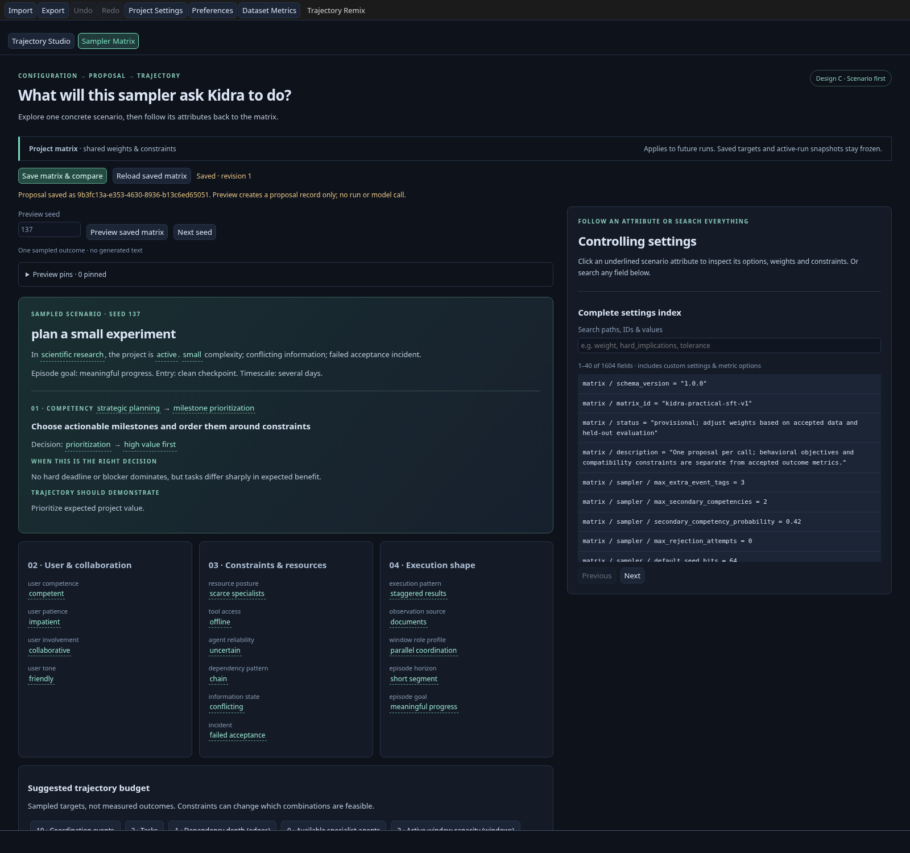
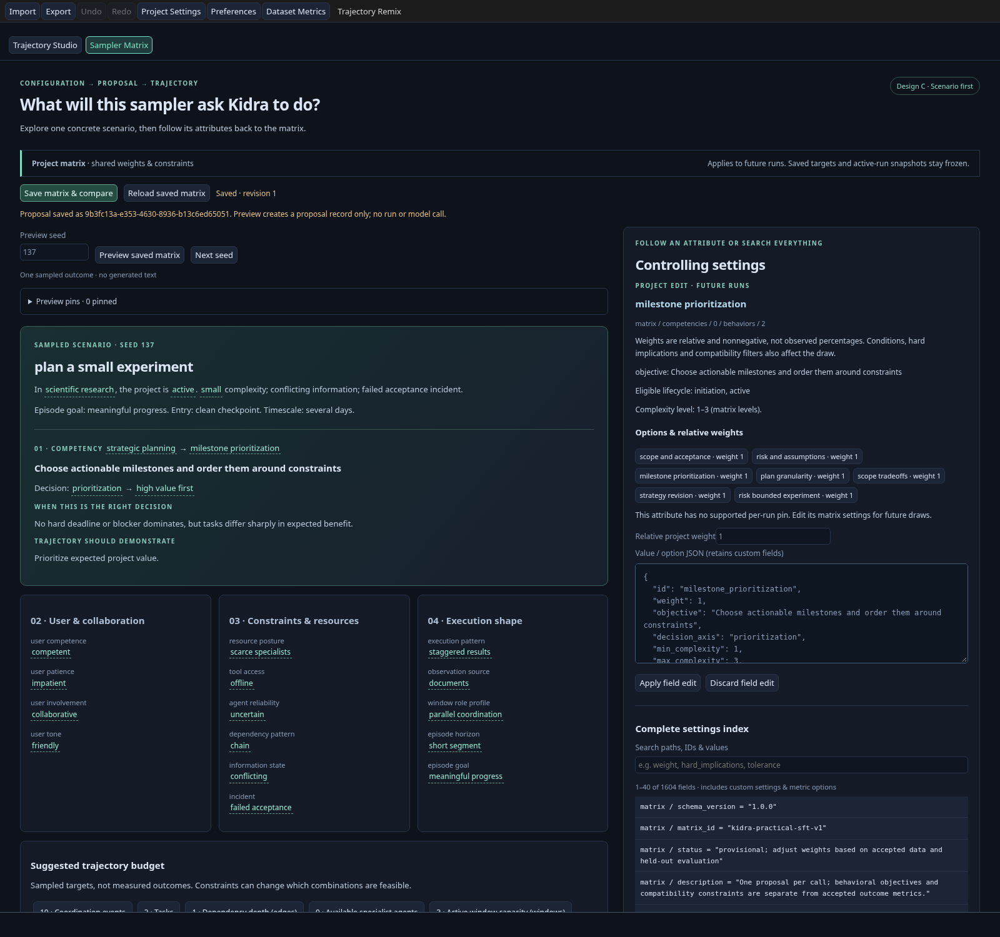
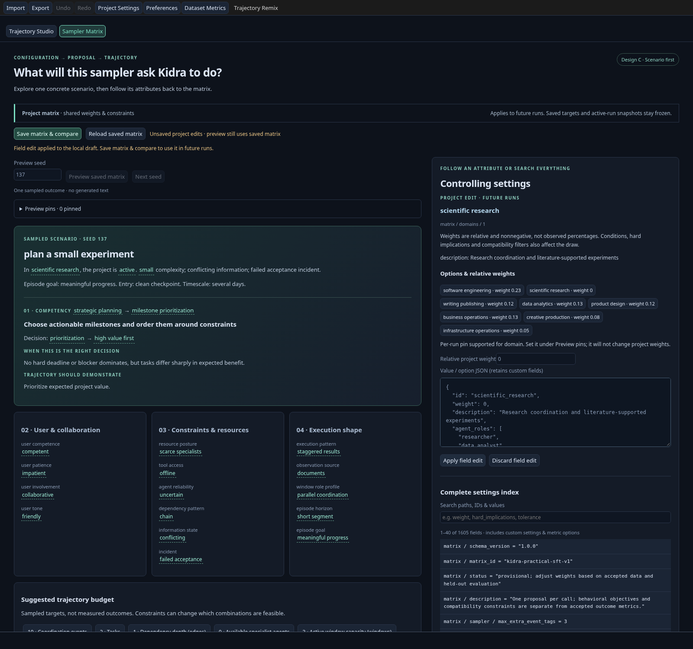
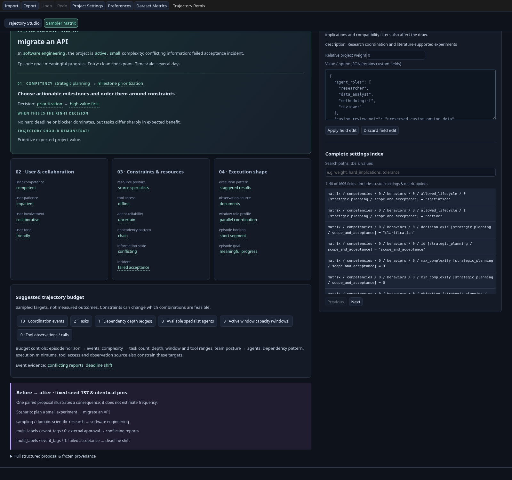

# Scenario-first sampler editor

The **Sampler Matrix** workspace starts with one concrete sampled project, the
competency it exercises, the condition making the chosen decision valid, and the
behavior a trajectory should demonstrate. User, resource and execution cards
connect that brief to the settings that shape future proposals. Suggested budgets
use counts and explicit units; they are targets, not measured results.

## Workflow

1. Open Sampler Matrix. Seed 137 produces the first structured proposal through
   the existing REST sampler. No model writes the brief.
2. Click an underlined competency, decision or scenario attribute. The inspector
   shows its controlling option, sibling weights, eligibility constraints and
   related conditional-weight/hard-implication rules. Change a relative weight
   numerically or edit the option JSON, then **Apply field edit**.
3. **Save matrix & compare** persists the draft with the settings revision guard
   and previews the same seed and pins. The comparison lists changed target
   fields and project archetypes. Without a matching previous seed and pins,
   it explicitly declines to present a paired comparison.
4. **Next seed** explores another single proposal. **Preview pins** exercises only
   the overrides supported by the backend. These controls neither edit project
   weights nor start a run. Incompatible pins surface the backend error and
   retain the last successful proposal.
5. Search the **Complete settings index** for any path, option ID or value,
   including custom fields, metric options, hard implications and settings unused
   by this proposal. All leaf fields and empty containers are reachable through
   pagination. Option JSON preserves custom properties; empty metric options can
   be populated through their index entry.

Project edits affect future runs. Previously stored proposals, targets and active
run snapshots stay frozen. Revision conflicts keep the local draft. Reloading the
saved matrix explicitly replaces local edits. Field text must be applied or
discarded before switching inspectors or saving. Preview responses from a newer
settings revision are rejected until the editor is reloaded.

The existing Trajectory Studio, Dataset Metrics panel and application controls
remain available. The UI calls `GET/PUT /api/v1/sampler` and
`POST /api/v1/sampler/proposals`; it contains no sampling algorithm, adaptive
balancing, tokenizer calls or model calls.

## Screenshots

One seed, one scenario brief:



Following a competency reveals its objective and eligibility constraints:



Changing the sampled domain's project weight, with the original scenario still
visible until save:



Saving compares the original research scenario with an API migration at the same
seed and pins. Other target changes remain visible rather than being attributed
solely to the edited domain:



## Tradeoffs and review questions

- A concrete brief makes decision intent and causal conditions approachable, but
  one draw cannot establish frequencies. The editor labels it as a proposal and
  exposes seeds, weights and constraints without inventing distribution charts.
- The shared API previews saved configuration only. Comparing an edit therefore
  requires saving project settings first. The UI disables preview for unapplied
  project drafts and states the future-run scope beside the save control.
- Preview creates a durable immutable proposal record with the existing API.
  Each button press stores a proposal, even though no generation run starts.
- Common weights and event probabilities have numeric inputs; uncommon nested
  settings use JSON to retain arbitrary fields. The complete index favors
  discoverability and lossless edits over a bespoke form for every matrix field.
- Budget buttons expose their primary controlling dimension; adjacent explanatory
  text names additional constraints. They do not claim a full causal trace of
  the sampler or relax an incompatible combination.
- Browser seeds are restricted to safe JavaScript integers so a displayed seed
  cannot silently round before reaching the sampler.

Review questions: Does the objective → decision condition → execution shape make
the intended trajectory clear? Are the distinctions between a project weight,
preview pin and sampled outcome sufficient? Which additional settings merit
dedicated form controls after comparing designs?

## Small validation

```sh
.venv/bin/python -m pytest tests/test_graph_sampling.py -q
npm ci --prefix tests
.venv/bin/python tests/run_graph_frontend.py
CHROMIUM_PATH=/usr/bin/chromium .venv/bin/python tests/run_sampler_browser.py
```

The browser runner creates a temporary project without tokenizers. It checks
attribute links, numeric weights, fixed-seed comparison, pin isolation/errors,
seed variation, custom-field/metric-option round trips, revision conflicts,
historical proposals, narrow-screen access and the existing metrics panel.
Set `SAMPLER_SCREENSHOTS=docs/screenshots/sampler-scenario` to refresh screenshots.
No benchmarks, training or live LLM calls are part of these checks.
