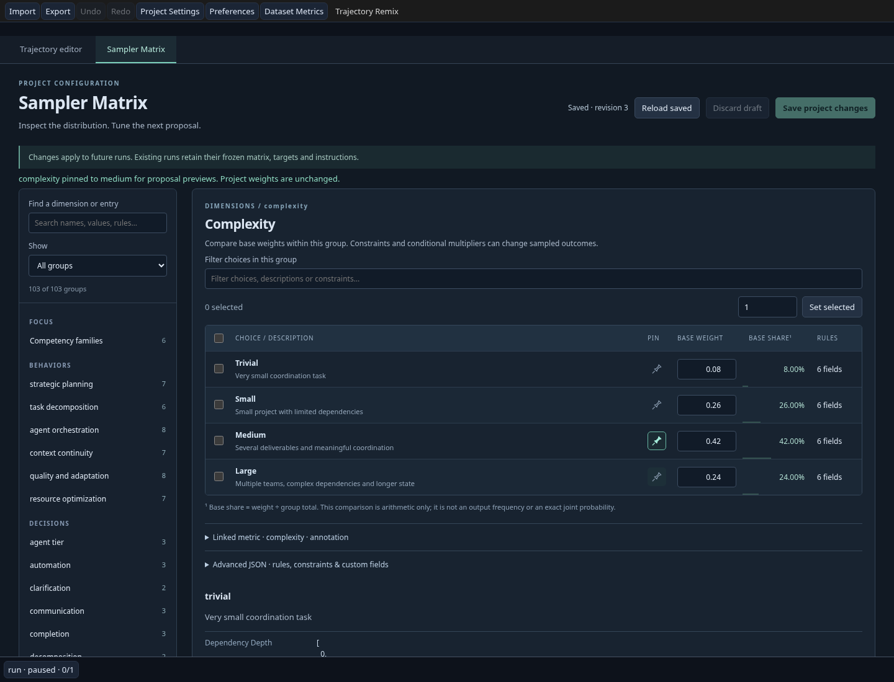
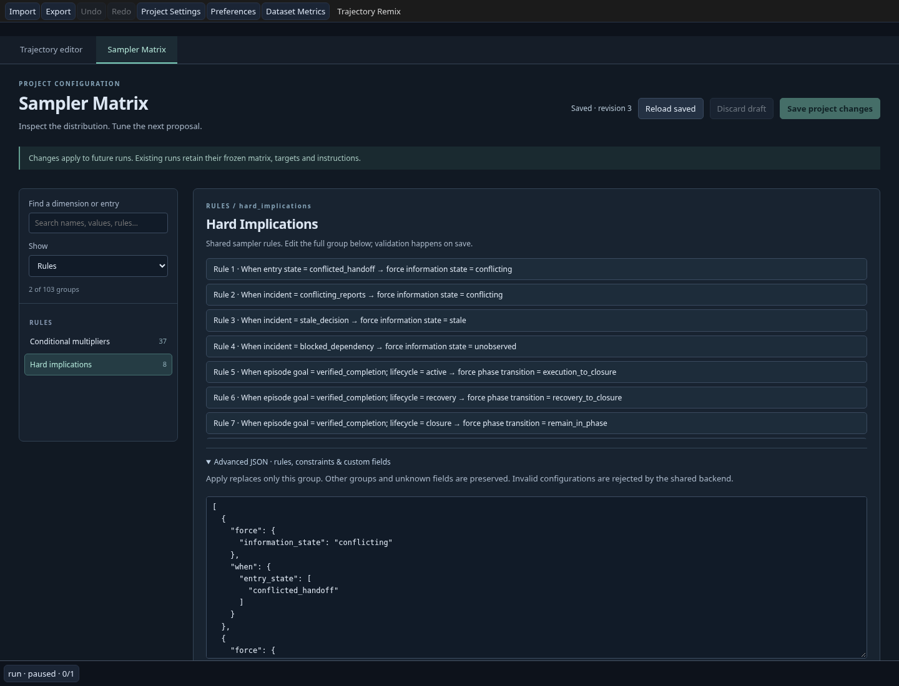

# Sampler Matrix workbench (UI B)

UI B adds a dedicated **Sampler Matrix** tab to Graph Studio. It uses the shared
sampler and linked metric registry from #75, based on
`2e91fff48a177355d8b52f6877c9c0f7e017ca64`. No sampler, schema, backend or generation
semantics change. This is one design alternative for review.

## Quick tuning workflow

1. Open **Sampler Matrix**. Search names, descriptions or serialized constraints;
   filter navigation to Dimensions, Behaviors, Decisions, Rules or Metrics.
2. Select a group. Filter its choices, compare aligned numeric weights and base
   shares, and edit with the keyboard. Select multiple choices and **Set selected**
   for repeated changes. This action affects only checked entries in that group;
   checks remain selected even when a choice filter hides them.
   The **Pin** column, between the description and base weight, has a small pin
   button for each supported choice. Muted means unpinned; a highlighted, filled
   pin means selected. Click again to unpin; picking a sibling moves the pin.
   Pins stay synchronized with the preview dropdowns and survive group/filter
   navigation. They apply to proposal previews only, without editing weights or
   saving project changes. Fields the shared sampler cannot pin show a dash.
   Each button supports keyboard activation and exposes its pressed state.
3. Click a choice to inspect constraints and referencing conditions. Expand its
   linked metric to edit label, units, target description and per-metric absolute
   and relative tolerance bands. Both bands are required together; clearing both
   leaves tolerance unspecified. Unknown actuals remain unavailable in the existing
   **Dataset Metrics** panel.
4. Use **Advanced JSON** for arbitrary constraints, rules and custom fields.
   **Apply JSON to project draft** affects only the current group. It does not save.
   Unapplied JSON text is a local buffer; apply it before leaving the group.
5. **Save project changes** persists the full matrix and metric customizations via
   a settings revision check. A rejected save retains the draft. On a revision
   conflict, copy the group JSON, reload the latest saved configuration, and
   reapply the intended changes. Reload and discard prompt before losing changes.
6. Expand **Proposal preview** after saving. Set a fixed integer seed and optional
   supported per-request pins. Sample one proposal; inspect its payload/matrix
   digests and settings revision. Pins never change weights. Preview uses the
   saved configuration at request time and creates an immutable proposal snapshot.
   It does not start generation. Existing runs retain their frozen inputs.

## Interpretation and tradeoffs

- Base share is only `weight / group total`. Conditional multipliers, eligibility,
  forced propagation and joint balancing are evaluated by the original sampler.
  Base shares are neither measured output frequencies nor exact joint probabilities.
  Event tags instead show their unnormalized base probabilities and explain caps.
- The navigation and compact choice table support scanning and repeated edits;
  detailed constraints remain below the table. This avoids placing arbitrary nested
  rules in every row, at the cost of an extra inspection click or vertical scroll.
- Repeated edits are intentionally scoped to selected choices within one group.
  There is no cross-group bulk rewrite or spreadsheet paste mode.
- Advanced nested constraints use JSON with shared backend validation rather than
  a second visual rule language. Unknown fields round-trip through the full cloned
  matrix. Editing JSON is an explicit replacement of that group, so omitted fields
  in a user-edited replacement are removed deliberately.
- Preview requires saving first because the shared proposal endpoint samples the
  saved project, not an unsaved browser matrix. The browser does not reinterpret
  sampler behavior. Concurrent external changes can affect which saved revision
  the preview uses; its returned revision and digest identify the actual input.
- Weight keystrokes update only the draft, share cells and navigation summaries.
  The detail pane does not rebuild, retaining focus and selection. Group/table
  scroll and checked choices survive saved updates. Project drafts remain local
  to this browser tab; there is no automatic conflict merge or global project Undo.
- Narrow screens stack navigation above details. The dense numeric table scrolls
  horizontally inside its own container. Desktop is the primary tuning surface.

## Screenshots

Real Chromium against a temporary local project; no model calls.





## Small correctness and browser checks

```sh
python -m pytest -q tests/test_graph_sampling.py
python tests/run_graph_frontend.py
python tests/run_sampler_frontend.py
```

The sampler browser check needs optional `playwright` resolvable by Node and a
Chromium executable (`CHROMIUM_PATH`, default `/usr/bin/chromium`). The existing
Graph Studio DOM suite needs the optional dependencies in `tests/package.json`.

The real-browser check uses one temporary SQLite project and a handful of seeded
proposals. It checks navigation/search/filtering, keyboard focus, repeated edits,
inline pin toggles/exclusivity/keyboard/navigation, dropdown synchronization and
actual preview overrides, custom-field and metric-tolerance persistence, invalid constraints and numeric
edits, revision conflicts, fixed seed/pins, run snapshot isolation, page reload and
narrow layout. Screenshots are refreshed by that check. The existing sampler suite
covers exact originals, deterministic overrides and frozen target behavior.
No benchmarks, training, live LLM calls or compiler/tokenizer operations run in
the new browser check.

## Review points

Compare the speed of finding a dimension, inspecting a constraint and repeating
weight edits with UI A/C. Assess table density, navigation grouping, visibility of
saved versus draft state, JSON-only rule editing and the save-before-preview step.
This prototype does not select a winning design or replace the metrics panel.
