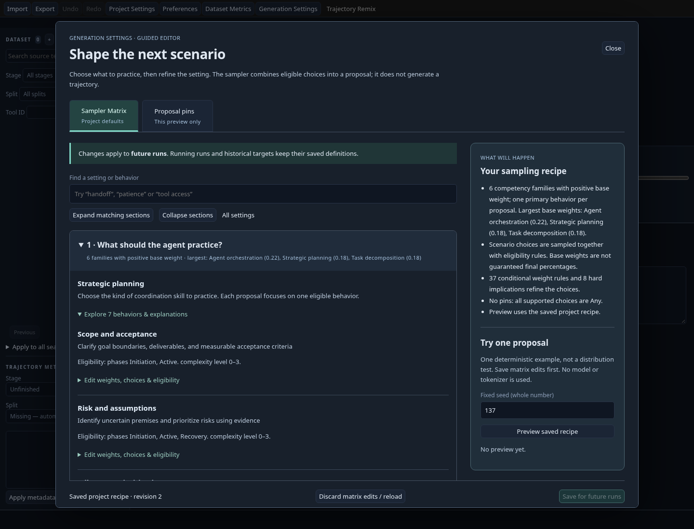
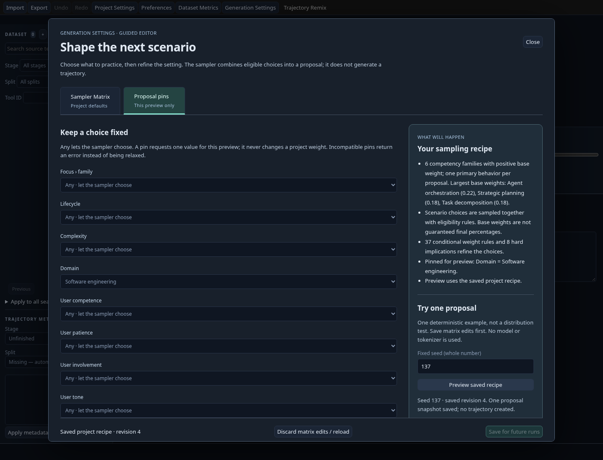
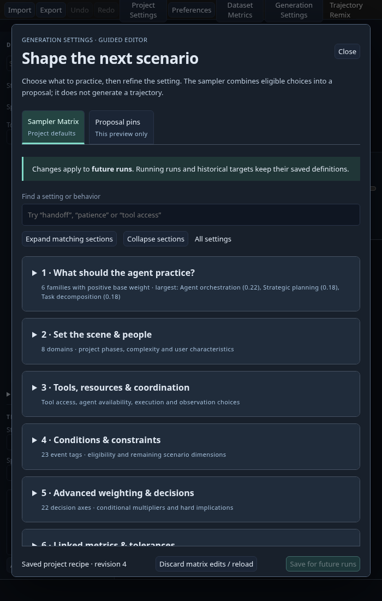

# Guided sampler editor (UI A)

This alternative starts at sampler/registry PR #75, commit
`2e91fff48a177355d8b52f6877c9c0f7e017ca64`. It uses that branch's REST API and
original sampler unchanged. It does not select a winner among the three UI designs.

## Walkthrough

1. Open **Generation Settings → Sampler Matrix**. The six numbered sections
   introduce competencies, scene/people, resources/coordination, conditions,
   advanced weighting, and linked metrics.
2. Expand a family and **Explore behaviors & explanations**. Read the objective
   and eligibility before opening **Edit weights, choices & eligibility**.
   Search matches the actual matrix IDs, descriptions, nested rules and registry.
   Expand/collapse controls act on the matching top-level sections.
3. Change a typed field. The recipe summary shows active families and largest
   base weights; it explains eligibility, conditional rules and snapshot boundaries.
   **Save for future runs** uses the shared revision guard and registry derivation.
4. In **Proposal pins**, leave **Any** for automatic selection or fix a supported
   choice. Pins are session-local preview overrides, separate from saved weights.
   Reset clears all pins. Arrow keys, Home and End move between the two tabs.
5. Preview a saved recipe with a fixed whole-number seed. The result explains the
   learning objective, decision, why it fits, setting, resources and numeric targets.
   A repeat preview compares categorical choices and numeric targets. Full target
   data and provenance remain available in a disclosure. Preview creates a durable
   proposal snapshot through `/sampler/proposals`; it does not create a trajectory.
6. Use the existing **Dataset Metrics** panel for observations and explicit missing
   metric calculation. Linked per-metric tolerances have no automatic defaults:
   supply both absolute metric-unit and relative fractional bands, or clear both.

Matrix edits require saving before preview because #75's shared API previews the
saved configuration. Errors remain in the dialog and receive focus. Invalid pins
are never silently relaxed. Conflicts preserve the local draft; reload is an
explicit discard action. Escape/Close retain the draft for reopening.

Unknown/custom matrix fields survive round trips. Advanced disclosures offer
typed controls for existing nested fields, including custom data. Stable IDs stay
read-only to avoid breaking references. The prototype does not add/remove category
or rule rows; those structural changes remain outside this UI design slice.

## Tradeoffs

- Explanations and progressive disclosure reduce the initial numeric burden and
  use the real source descriptions. Large families and long advanced rules still
  require scrolling and nested disclosure navigation.
- The summary stays alongside the editor on wide screens and stacks on narrow
  screens. It reports base-weight priorities and constraints, not estimated final
  percentages or claims about observed coverage.
- Saved-only preview keeps the API common across alternatives, at the cost of an
  explicit save before trying matrix edits. Pins can be tried immediately.
- Pins do not start a run here: the shared prerequisite reports the generation
  driver as unavailable. They exercise the same supported overrides future runs
  consume. This branch adds no backend, schema, Monte Carlo, compiler or model logic.
- Metric customization lives beside its linked definitions; actual observations
  stay in the existing Dataset Metrics panel.

## Review questions

- Are the six groups understandable without prior knowledge of the matrix?
- Does opening a behavior explanation before its numeric controls provide enough
  guidance, or do you prefer fewer nested disclosures for frequent editing?
- Does the recipe plus one example explain the resulting behavior clearly enough
  to decide whether to save a change, given the saved-only preview API?

## Small validation

```sh
.venv/bin/pip install -e '.[test,export]'
npm ci --prefix tests
# Install Chromium separately, or point CHROMIUM_PATH to an installed executable.
.venv/bin/python -m pytest -q tests/test_graph_sampling.py tests/test_graph_studio.py
.venv/bin/python tests/run_graph_frontend.py
.venv/bin/python tests/run_sampler_guided.py
```

The real Chromium suite uses one temporary project, a custom-field fixture and
only a few deterministic proposals. It checks source round trips, snapshot
retention, linked tolerances and validation recovery, pins versus project weights,
repeat-seed equality, incompatible pins, search/expand navigation, keyboard tabs,
Escape/reopen, responsive overflow and conflict draft retention. It also rejects
page errors and verifies no compiler-preview or run requests were made. Screenshots
are written to `work/sampler-guided/`; the checked-in captures below are from that
fixture. Backend snapshot isolation is also covered by the existing sampler suite.
No benchmarks, load tests, full training or live model calls are part of this work.

## Screenshots






