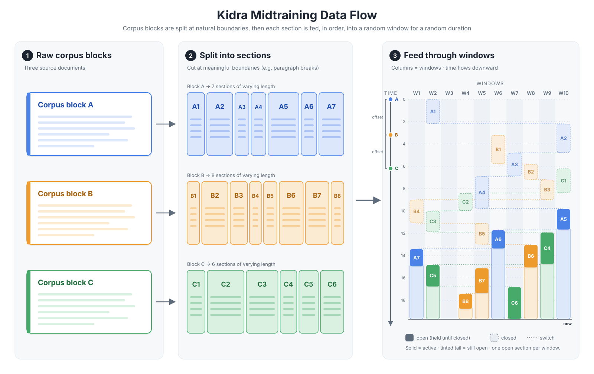

# KTREMIX Rust crate

`ktremix` compiles Trajectory Remix graph JSON and raw corpus text into KTREMIX
1.0 training shards, and reads them back for training. For how this crate fits with
the Python package and the studio, see [Native compiler](../../docs/NATIVE-COMPILER.md).

## Use it

Depend on the crate by path or Git revision:

```toml
[dependencies]
ktremix = { git = "https://github.com/TheDudeFromCI/trajectory-remix", package = "ktremix" }
```

```rust
use ktremix::{Compiler, Options, TokenizerProfile};

let profile: TokenizerProfile = serde_json::from_str(&std::fs::read_to_string("profile.json")?)?;
let compiler = Compiler::new(profile, None, Options::default())?;
let source = std::fs::read_to_string("trajectory.json")?;
let compilation = compiler.compile(&source)?;
println!("{} rows", compilation.columns.token_ids.len());
```

Browse the full API with `cargo doc --no-deps --open -p ktremix`.

## What is in the crate

- `Compiler` compiles graph sources and runs diagnostics with or without a
  tokenizer profile. Use `shard::CompileWriter` to write batches to disk.
- `Compiler::convert_corpus` converts UTF-8 text, JSONL, or a document iterator
  into training shards.
- `shard::Shard` reads individual samples. `dataset::Dataset` adds weighted
  batching and optional sampling without replacement across shards.

## Compiler warnings and errors

`Compiler::structural_report` checks graph structure without a tokenizer.
`Compiler::report` also checks tokenization and scheduling. Warnings allow
compilation and appear in `Compilation::report` on success. Errors block
compilation. Each diagnostic includes a code, a message, and a source path
where applicable. Tool catalog, tool schema, configured response window, and
reasoning level checks use the optional settings supplied by the caller.

| Severity | Code | When it is emitted |
| --- | --- | --- |
| Warning | `duplicate_dependency` | An event lists the same dependency more than once. |
| Warning | `low_agent_share` | Agent text and tool calls account for less than 6.25% of the source text characters. |
| Warning | `open_window` | A used reasoning or tool window has no closing event and lacks the `intentionally_left_open` flag. |
| Warning | `tool_input_schema` | A submitted call's arguments fail JSON or schema validation, the configured schema is invalid, or window references defer validation. |
| Warning | `unknown_tool` | A call names a tool ID missing from the supplied catalog. This check runs when settings are supplied. |
| Error | `call_already_finished` | A request adds a fragment after submission or cancellation. |
| Error | `chat_echo_disabled` | A linked chat message echoes a call whose fragments disable echo. |
| Error | `chat_echo_mismatch` | A linked chat message differs from the submitted `chat` call's content. |
| Error | `compile_error` | Tokenizer-backed compilation fails, for example because of invalid literal encoding, an incompatible window-reference alphabet, or an exceeded window or row limit. The message gives the cause. |
| Error | `dependency_cycle` | An event belongs to a dependency cycle. |
| Error | `empty_replacement` | A body replacement contains neither text nor a window reference. |
| Error | `inconsistent_call` | Request fragments with the same call ID disagree on the tool ID or window. |
| Error | `inconsistent_response` | Response fragments with the same call ID use different windows. |
| Error | `interleaved_framing` | Another request or response, or nonempty standalone content, interrupts an open request or response in the same window. |
| Error | `invalid_chat_window` | A chat message targets a window whose purpose differs from `chatroom`. |
| Error | `invalid_response_begin` | The first response fragment lacks a begin marker, or a later fragment inserts one. |
| Error | `invalid_source` | The source cannot be decoded as graph JSON, uses an unsupported graph format, or contains invalid identifiers, window definitions, event fields, or loss weights. |
| Error | `invalid_tool_begin` | The first request fragment lacks a begin marker, or a later fragment inserts one. |
| Error | `missing_dependency` | An event depends on an event ID absent from the graph. |
| Error | `missing_window` | An event targets a window ID absent from the graph. |
| Error | `missing_window_reference` | An inline window reference names a window ID absent from the graph. |
| Error | `output_after_close` | An event writes to a logical window after a causal predecessor closes it. |
| Error | `response_already_finished` | A response adds a fragment after its end marker. |
| Error | `response_window` | A response targets a different window from the one configured for the tool. |
| Error | `unknown_reasoning_level` | A window uses a reasoning level absent from the supplied settings. |
| Error | `unopened_window_reference` | An inline reference names a defined window that has no events to open it. |
| Error | `unordered_window_writers` | Two events write to the same window without a dependency path ordering them. |
| Error | `unsubmitted_call` | A tool response or linked chat echo lacks a causally preceding submitted request for its call ID. |
| Error | `window_not_writable` | Agent output targets a read-only window. |

### Errors returned by the Rust API

Methods that return `Result` can also return these `ktremix::Error` variants.
Use the report methods for structured diagnostic codes. A failed
`Compiler::compile` returns a summary of its blocking diagnostics.

| Variant | When it is returned |
| --- | --- |
| `Invalid` | The library rejects input, options, a tokenizer profile, or a shard. The message gives the reason, including any blocking compilation diagnostics. |
| `Cancelled` | A cancellation callback stops the operation. |
| `Json` | JSON parsing or serialization fails outside the structured graph diagnostic report. |
| `Io` | A file operation fails. |

## What a compiled trajectory looks like

A **row** is one token occurrence in one window. A text token, a beginning-of-window
token (`BOS`), an end-of-window token (`EOS`), and an idle decision (`NOOP`)
each get a row. One compiled frame can contain several rows. External inputs can
arrive first, followed by model predictions in several windows at once.

Here are five rows from the ten-row KTREMIX format fixture. The token IDs in
this example are specific to the fixture.

| Row | Frame | Window | Token ID | Meaning | Query frontier | Loss weight |
| ---: | ---: | ---: | ---: | --- | ---: | ---: |
| 5 | 1 | 1 | 3 | Model predicts `NOOP` | 3 | 0.1 |
| 6 | 1 | 2 | 3 | Model predicts `NOOP` | 3 | 0.1 |
| 7 | 2 | 0 | 200 | External text arrives | 3 | 0 |
| 8 | 2 | 1 | 2 | Model predicts `EOS` | 4 | 1 |
| 9 | 2 | 2 | 3 | Model predicts `NOOP` | 4 | 0.1 |

A **query frontier** marks what has happened by the time a token is constructed
or predicted. The two predictions in frame 1 share frontier 3. The external
text in row 7 becomes visible at frontier 4, so the model predictions in rows
8 and 9 can see it. A durable row is visible from `visible_from` up to, but
excluding, `visible_until`. `NOOP` and `EOS` never become visible context.
Loss is separate from visibility. The fixture supervises `NOOP` at weight 0.1,
while raw corpus conversion defaults to zero loss for `NOOP`.

### How the shard stores it

`Compiler::compile` returns these values as typed arrays in `Compilation::columns`.
A `.ktremix` shard stores a file header, a JSON manifest, a sample index, and one
independently compressed or raw record per sample. The index lets a reader jump
directly to a record. Inside that record, each column is a contiguous array. For
example, row 7 uses `token_ids[7]`, `window_ids[7]`, and `loss_weights[7]` from
separate arrays.

| Columns | What they describe |
| --- | --- |
| `token_ids`, `window_ids`, `position_ids`, `row_flags` | The token, its window instance, its position in that window, and flags such as `NOOP` |
| `query_frontiers`, `visible_from`, `visible_until`, `previous_rows` | When the row is constructed, when it can be seen, and its visible same-window prefix |
| `frame_offsets` | Row boundaries for each frame. In the fixture, `[0, 5, 7, 10]` puts rows 5 and 6 in frame 1 |
| `window_slots` and window frontier and flag arrays | Each window instance's physical slot, lifetime, activation, and flags. A later window can reuse a slot |
| `loss_weights`, `target_rows` | Loss weight per row and the sorted indices with positive weight |

Open a shard with `shard::Shard::open`, then use `read(index)` to load one sample.
`Sample::column("token_ids")` exposes the token column as little-endian bytes.
For training, `target_rows` indexes the labels directly. `previous_rows` supplies
their same-window prefix, and the visibility intervals determine cross-window
context. [KTREMIX 1.0 binary specification](https://github.com/TheDudeFromCI/trajectory-remix/blob/main/docs/KTREMIX.md)

## Kidra midtraining data flow

The corpus converter splits documents at meaningful boundaries, interleaves
sections across windows, and writes KTREMIX training shards.


